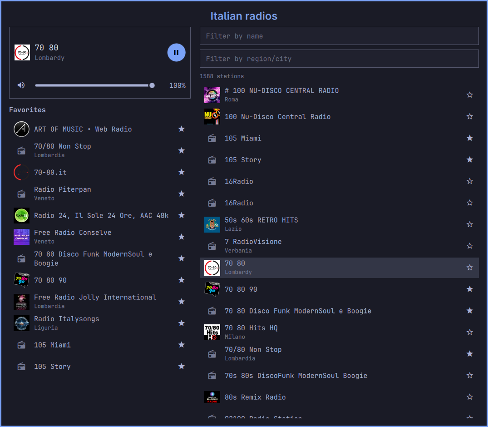

# Italian radios

An Omarchy plugin for listening to Italian radio.



Thanks to [Akshar Patel](https://github.com/AksharP5/omarchy-radio-atlas) (akshar.radio-atlas) and [Jordan Thomas](https://github.com/JMThomas00/omarchy-vantage) (jmthomas00.vantage) for the inspiration.

## Install

```bash
omarchy plugin add https://github.com/impero365/omarchy-italianradios.git --enable
```

## Remove

```bash
omarchy plugin remove impero365.radio-italia
```

Dependencies (already included in Omarchy):

- `mpv`
- `bubblewrap` (`bwrap`)
- `socat`
- `python` (`python3`)
- `iproute2` (`ip`)
- `util-linux` (`setpriv`)

## License

MIT. See [LICENSE](LICENSE).
